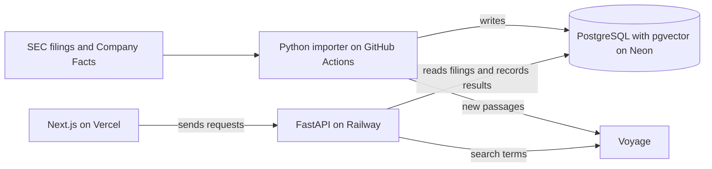

# Financial Document Retrieval Engine

FDRE lets you search and compare the annual and quarterly reports companies file with the SEC
(10-Ks and 10-Qs). [Open the research panel](https://thefdre.com) · [How it works](#architecture)

## Using the research panel

- **Ask** a question and read the filing passages cited in the answer. If there's too little
  evidence, Ask says so.
- **Retrieve** a passage by company, date, or filing section. This tab also lets you compare
  filings, look up financial figures, and export data as CSV, JSON, or Parquet.
- **Screen** companies by topic. Try `data center construction` to see which companies discuss
  it, what they said, and when they filed.
- **Signals** shows how stocks performed after a filing. Open a saved study to check its data
  and assumptions.

The **as-of date** limits a search to filings the SEC had accepted by then. A March quarterly
report filed in May won't appear in an April search. If you're studying the S&P 500 in a past
year, check which companies belonged to it then. Some have since left the index.
[Historical membership guide](docs/research/historical_universe.md)

## Run the local demo

You'll need Python 3.11 or later, uv 0.12.10, Node.js 22, and Docker with Compose. The demo
loads one fictional annual report and runs without API keys.

From the top of a fresh checkout, start the database, load the sample filing, and run the API.

```bash
cp -n .env.example .env
uv sync --frozen --extra dev --extra data
docker compose up -d --wait postgres
uv run alembic upgrade head
uv run python -m scripts.pipelines.retrieval_pipeline seed-demo
uv run uvicorn apps.api.app.main:app --reload
```

Open a second terminal in the repository root and start the web app.

```bash
cd apps/web
cp -n .env.example .env.local
npm ci
npm run dev
```

Open the [local research panel](http://localhost:3000), choose **Retrieve**, and search for
`subscription demand`. The `EXMPL` filing says, “Revenue increased because subscription demand
grew.” You can try the same search with `POST /search` in the
[local API docs](http://localhost:8000/docs).

## Architecture

The importer and the API share one PostgreSQL database on Neon. A filing import runs as a
separate job on GitHub Actions. Searches read the filings already in the database.



### How filings are stored

The `documents` table records the company, SEC filing ID, and time the SEC accepted the
filing. The importer breaks the HTML into headings, paragraphs, and tables in
`document_elements`. It splits long paragraphs into shorter passages in `chunks` and keeps
table rows and column headings together. Each chunk points back to its source element and
filing. Reported figures from SEC Company Facts go into `financial_facts` with their unit,
reporting period, and filing ID. [Database models](apps/api/app/models/)

### How the vector index works

The production importer uses Voyage's `voyage-4-large` model to turn each searchable passage
into a list of 512 numbers called an *embedding*. PostgreSQL stores it in `embeddings` with
the chunk ID and model name. Each number uses two bytes (`halfvec`), so the 512 values take
about 1 KiB per passage before database and index overhead. Routine imports reuse existing
embeddings. The local demo uses a built-in provider.

Keeping vectors beside the filings lets one SQL query follow a vector match back to the
passage, check the filing date, and return the source link.

PostgreSQL has two search indexes. A **GIN** index maps words to passages for keyword
search. An **HNSW** index links nearby vectors from the same Voyage model. To find passages
about `equipment spending`, pgvector compares the direction of the query vector with nearby
passage vectors (cosine distance). That can find a passage about buying machinery even when
the wording differs. Following the links makes broad searches faster, though it can miss a
match that a comparison against every vector would find. [Index definitions](apps/api/alembic/versions/c2d4e6f8a101_add_retrieval_indexes.py)

### What happens on a request

- **Search.** For a query with a ticker, `POST /search` combines keyword and vector scores.
  Without a ticker, it searches by vector alone. In production, a broad search first gets a
  shortlist of passage IDs from the vector index, then loads their text and applies any
  filing filters. The API records which passages it returned and how they ranked.
  [Search code](apps/api/app/services/retrieval_service.py)
- **Answers.** Depending on the question, `POST /answer` reads filing text, tables, or reported
  figures. It ranks the evidence, checks that each claim cites a result, and compares the quoted
  words with that source. If the evidence is too weak or a citation fails, Ask says so. Only
  verified answers can be cached for repeat questions. [Answer workflow](src/fdre/answering/workflow.py)
- **Keeping the API responsive.** Each API process reuses a pool of database connections
  managed by SQLAlchemy. It caps the number of expensive requests that can run at once and
  gives each interactive SQL query a time limit. The importer skips filings already processed
  and records which stages finished.
  [API limits](docs/operations/runtime_limits.md) · [Architecture guide](docs/architecture/system.md)

On deployment, Railway runs Alembic to update the database schema before it starts the API.
Railway checks `/ready`, which runs a database query, before sending traffic to the new version.
[Deployment settings](railway.toml)

Before downloading SEC filings, put your name and contact email in `SEC_USER_AGENT` in `.env`.
Each paid indexing run needs your approval. If you use a paid search provider, it may also
charge for individual searches. [Cost policy](docs/operations/cost_budget.md)

## Research results

Reviewers marked the passages that answered each of 40 test questions. On average, 37.5% of
those passages appeared in the first ten results. The target is 85%. [Search benchmarks](docs/evaluations/eval_results.md#retrieval-benchmark)

One study asked whether changes in a company's risk disclosures could predict stock returns.
Too few later prices were available to settle the question.
[Study results](docs/evaluations/eval_results.md)

## Working with the code

Run `uv run python -m scripts.pipelines.retrieval_pipeline --help` to list commands for
indexing filings, importing financial figures, and exporting datasets. The
[contributor guide](CONTRIBUTING.md) lists the test commands and data rules.

The [documentation index](docs/README.md) lists the research guides. To check a saved study
without connecting to the database, follow the [experiment guide](docs/research/experiment-bundles.md).
